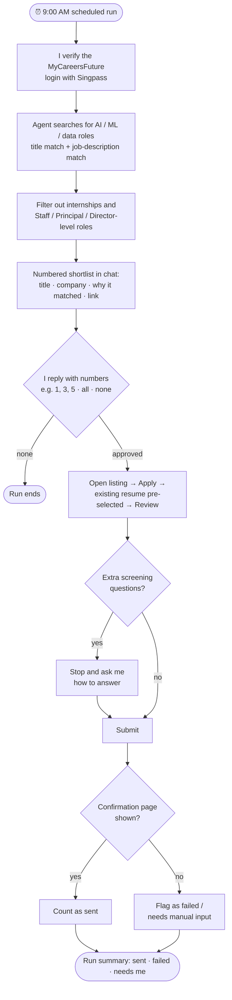

# MyCareersFuture Job Application Agent

An AI agent that searches [MyCareersFuture](https://www.mycareersfuture.gov.sg) every morning for AI/ML/data engineering roles, shortlists them for me, and — only after I approve — submits applications using the resume already on my profile.

Built as a **Claude skill** that runs as a **scheduled task** and drives a real browser through **Claude in Chrome**. No scraping scripts, no stored credentials: the agent follows a written runbook and acts inside a browser session I've verified myself.


---

## Why I built it

Job hunting on a portal is repetitive: run the same searches, skim the same listings, click through the same two-step apply flow. The judgement — *which* jobs are worth applying to — is the only part that needs me. So the agent does the repetitive parts and hands me the decision.

## How it works



1. **Search** — casts a wide net: titles like AI Engineer, ML Engineer, Data Scientist, MLOps and NLP Engineer, *plus* generic "Software Engineer" postings whose description mentions AI, ML, LLMs or data work.
2. **Shortlist** — presents a numbered list with a one-line reason for each match, then stops.
3. **Approve** — I reply with the numbers I want. Nothing is submitted without this.
4. **Apply** — follows a step-by-step apply procedure recorded from a live test run (see [`skill/SKILL.md`](skill/SKILL.md)).
5. **Report** — confirms what was submitted, what failed, and what needs my input.

## Design decisions

| Decision | Why |
|---|---|
| **Approval gate before every submission** | Applying is irreversible. The agent can search freely, but a human "yes" is required in chat before any application goes out. |
| **Login stays with me** | MyCareersFuture uses Singpass. I verify the login at the start of each run, so the agent never sees or stores credentials and can only act inside a session I've authenticated. |
| **Stop and ask instead of guessing** | If an application has screening questions beyond "submit with existing resume", the agent pauses and asks me. A made-up answer is worse than a short delay. |
| **Verify the outcome, not the click** | An application only counts as sent when the portal's confirmation page ("Your application is on its way!") appears. |
| **Runbook in the skill file** | The exact apply steps were recorded from a real run and written into the instructions, which made the agent reliable and gives anyone reading it a clear procedure. |
| **Reuse the resume on file** | No tailored resumes or cover letters — keeps runs fast and avoids the agent inventing claims about me. |

## Repository structure

```
.
├── README.md
├── LICENSE
└── skill/
    └── SKILL.md   # The agent: search criteria, approval flow, and apply runbook
```

## Running it yourself

1. Have a MyCareersFuture account with your resume already uploaded.
2. Add [`skill/SKILL.md`](skill/SKILL.md) as a skill in Claude, and connect **Claude in Chrome**.
3. Create a scheduled task that runs the skill daily (mine runs at 9:00 AM Singapore time), or just invoke it on demand.
4. When it runs, complete the Singpass login, review the shortlist, and reply with the numbers you want to apply to.

Edit the search titles and exclusions in `SKILL.md` to match the roles you're targeting.

## Limitations

- Needs me present at the start of each run for the Singpass login — a deliberate trade-off for never handing over credentials.
- Matching is keyword and description based; it doesn't score fit against my resume.
- The apply runbook reflects the portal's current two-step flow. If the site changes, the steps in `SKILL.md` need updating.

## Responsible use

This is a personal productivity tool. It applies only to roles I explicitly approve, at a human pace, using my own account. Please respect MyCareersFuture's terms of use if you adapt it.

---

Built by [Tan Song Jun](https://github.com/tansongjun).
